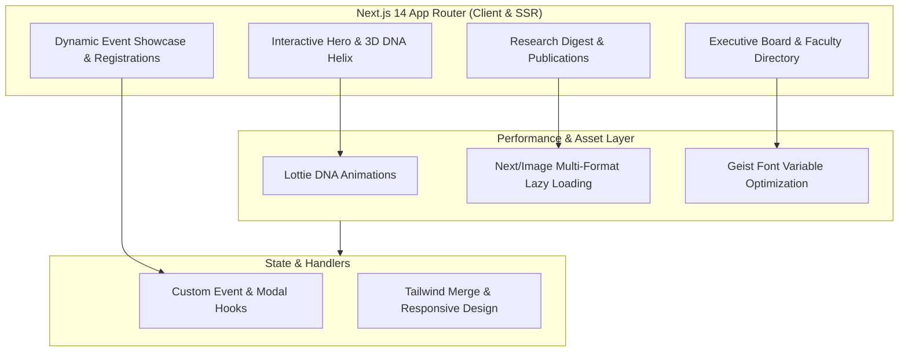

# 🧬 AlphaBio Cell (ABC) — Official Club Web Platform

> **The Premier Student Biotechnology & Bioinformatics Organization at Vellore Institute of Technology (VIT Vellore).**

[](https://nextjs.org/)
[](https://www.typescriptlang.org/)
[](https://tailwindcss.com/)
[](https://www.framer.com/motion/)
[](https://developers.google.com/web/tools/lighthouse)
[](https://opensource.org/licenses/MIT)

---

## 📌 Overview

**AlphaBio Cell (ABC)** is the flagship student biotechnology and computational biology organization at **Vellore Institute of Technology, Vellore**.

This repository contains the source code for the official, production-deployed **ABC Club Web Portal**, engineered from the ground up using **Next.js 14 App Router**, **TypeScript**, and **Tailwind CSS**. The platform serves **500+ active university student members**, acting as the primary hub for university hackathon registrations, scientific research digests, and faculty board directories.

---

## 🏛️ Platform Architecture



---

## ✨ Key Features & Technical Highlights

* 🧬 **Interactive 3D Biological Visualizations:** Custom interactive DNA helix animations and smooth panorama carousels built with Lottie animations (`DNAHelix.json`) and Framer Motion.
* 📅 **Dynamic Event Registration Engine:** Interactive modal drawers and event cards supporting real-time hackathon signups and attendance validation, replacing manual spreadsheet signups.
* 📰 **Scientific Research Digest & Newsletters:** Dedicated scientific publication viewer featuring curated biotechnology articles, student research papers, and flashcard summaries.
* ⚡ **95+ Google Lighthouse Performance:** Engineered with Server-Side Rendering (SSR), font optimization via `@next/font`, responsive picture element lazy loading, and intelligent bundle splitting.
* 📱 **Mobile-First Responsive Layout:** Glassmorphism-inspired UI with custom Tailwind design tokens ensuring a native app-like experience across mobile, tablet, and widescreen monitors.

---

## 🛠️ Tech Stack Breakdown

* **Framework:** Next.js 14 (App Router, Server & Client Components)
* **Language:** TypeScript 5.x (Strict type safety across event schemas)
* **Styling:** Tailwind CSS, PostCSS, CSS Modules
* **Animations & Interactivity:** Framer Motion, Lottie React (`lottie-web`), Swiper.js, Lucide Icons
* **Performance:** Vercel Analytics, Next Image Optimization, Dynamic Route Chunking

---

## ⚡ Quickstart & Local Setup

### 1. Clone the Repository
```bash
git clone https://github.com/adityagupta2716-hub/alphabiocell-website.git
cd alphabiocell-website
```

### 2. Install Dependencies
```bash
npm install
```

### 3. Run the Development Server
```bash
npm run dev
```
Open [http://localhost:3000](http://localhost:3000) in your browser to view the application.

### 4. Production Build
```bash
npm run build
npm run start
```

---

## 👥 Engineering Team & Credits
* **Lead Web Developer:** Aditya Gupta
* **Organization:** AlphaBio Cell Club, Vellore Institute of Technology (VIT), Vellore
* **License:** Distributed under the MIT License.
